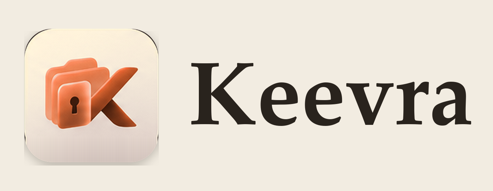

<p align="center">
  <picture>
    <source media="(prefers-color-scheme: dark)" srcset="brand/02_Wordmarks/Keevra_Horizontal_Dark.png" />
    
  </picture>
</p>

<p align="center">
  <strong>A local-first, encrypted account directory for Windows.</strong><br />
  Every service, every account, every optional detail — in one private place on your own machine.
</p>

<p align="center">
  <a href="https://github.com/Moltrax8/Keevra/actions/workflows/ci.yml"></a>
  
  
  
  
  
</p>

## Overview

Keevra is a Windows desktop app for keeping a personal inventory of the accounts
you have across the services you use. It is deliberately not a browser, a sync
service, or a cloud password manager: the vault is a single encrypted file on
your machine, and nothing leaves it unless you explicitly ask for an update
check or a download.

The interface is a two-pane directory: search and browse accounts grouped by
service on the left, edit the selected account on the right. Details save
themselves; there is no separate "save" button to forget.

## Features

- **Account directory** — one record per account: name, service, tags, and any
  optional fields you add (username, password, PIN, expiry, TOTP, recovery
  codes, notes, custom fields).
- **Service grouping** — accounts are grouped by service with counts; an
  optional picture can be set per service.
- **Quick add** — type a name, optionally a service, press Enter.
- **Auto-save and undo/redo** — edits commit on blur or after a short pause;
  undo and redo cover the whole vault.
- **Encrypted attachments** — add files to an account; blobs live beside the
  vault and are encrypted with the same session key.
- **Portable packages** — export and import an encrypted package that includes
  the vault and its attachments.
- **Locked by default** — Argon2id-derived key, masked secrets, and a 5-minute
  inactivity auto-lock (save-then-lock).
- **Warm paper theme** — light and dark palettes, match-system by default.

## Security model

- **Local-only.** No cloud accounts, sync, telemetry, or analytics.
- **Encryption.** Argon2id key derivation + XChaCha20-Poly1305 authenticated
  encryption (envelope v1). The master key exists only in zeroized Rust memory
  while the vault is unlocked.
- **Atomic saves.** Writes go to a temporary file and are verified before the
  old vault is replaced; a verified `.bak` backup is kept for explicit restore.
- **Least privilege.** The React frontend talks to a narrow set of Tauri IPC
  commands; the Rust side owns all cryptography and file access.
- **Masked secrets.** Field values are hidden until you explicitly reveal them.
- **Clipboard clearing.** Copied secrets are wiped after 30 seconds and on lock,
  but only if the clipboard still contains the value Keevra copied.
- **Auto-lock.** Five minutes of inactivity saves and locks the vault.

The full design authority is [`docs/THREAT_MODEL.md`](docs/THREAT_MODEL.md).

## Privacy and network access

The only network access is the notify-only update check:

- an unauthenticated HTTPS `GET` to
  `https://api.github.com/repos/Moltrax8/Keevra/releases/latest`;
- optional HTTPS downloads of `updates.json`, its signature, and the installer
  from GitHub release assets, only after you click.

The check sends no vault contents, account data, local paths, or telemetry.
GitHub sees the machine's IP and request time, as with any HTTPS request.
See [`docs/UPDATER_SECURITY.md`](docs/UPDATER_SECURITY.md).

## Status

Keevra is **pre-1.0**. Encryption, auto-lock, attachments, packages, and the
updater are in place. This is the first public source release. Windows binaries
are published only after they are Authenticode-signed, so a signed installer is
not available yet; use **fake data only**.

## Install

Build from source until the signed installer is published:

```powershell
npm ci
npm run tauri build
```

The NSIS installer is written under `src-tauri/target/release/bundle/nsis/`.
Local builds are unsigned and must not be redistributed (see
[`docs/RELEASE_SECURITY.md`](docs/RELEASE_SECURITY.md)).

Requirements: Windows 10/11 (x64) with WebView2.

## Development

Requirements: Node.js 22+, Rust stable, Windows MSVC build tools, and WebView2.

```powershell
npm install
npm run tauri dev
```

Useful commands:

| Command | What it does |
|---|---|
| `npm test` | TypeScript unit tests (Node-only) |
| `npm run build` | Type-check and production frontend build |
| `cargo test --manifest-path src-tauri/Cargo.toml` | Rust unit tests |
| `npm run tauri build` | Release build and NSIS installer |

## Project layout

```
src/            React + TypeScript UI
src-tauri/      Rust backend, Tauri config, Windows icon
docs/           Architecture, threat model, release and updater security
brand/          README wordmarks and brand-asset terms
tools/          Maintainer-only update-manifest tool
```

## Brand assets

The README wordmark lives in [`brand/02_Wordmarks`](brand/02_Wordmarks); the
in-app mark is bundled from `src/assets/`. Usage terms are in
[`brand/LICENSE.md`](brand/LICENSE.md).

## Documentation

- [Architecture](docs/ARCHITECTURE.md)
- [Threat model](docs/THREAT_MODEL.md)
- [Release security](docs/RELEASE_SECURITY.md)
- [Updater security](docs/UPDATER_SECURITY.md)
- [Security policy](SECURITY.md)
- [Contributing](CONTRIBUTING.md)

## License

MIT © 2026 MOHAMMADAMIN TOGHIPOUR. See [LICENSE](LICENSE).
